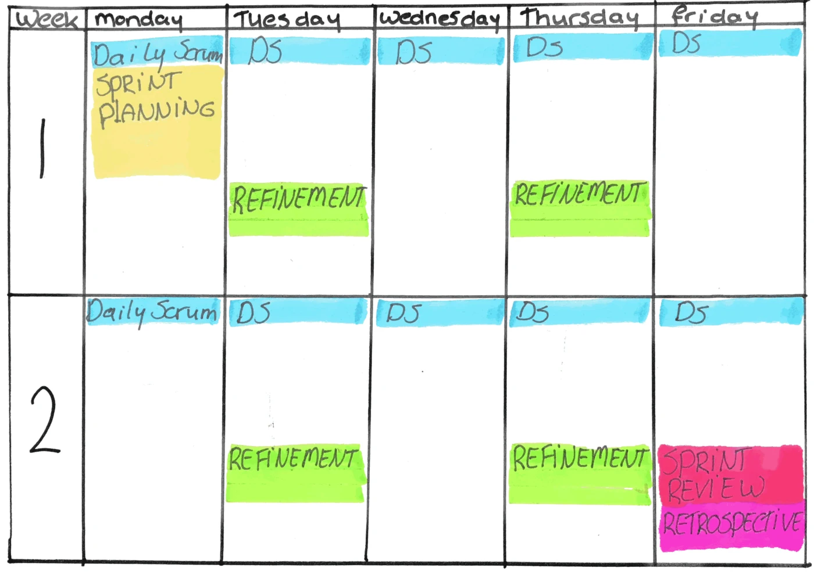

# Scrum

Scrum is a framework for developing and delivering complex products. A Scrum Team is small, typically ten or fewer people, and works in **sprints**: fixed-length iterations of one month or less. Most teams use one or two weeks, because shorter sprints mean faster feedback. Each sprint has a goal, a one or two sentence statement that tells stakeholders what the team is working toward.

The [Scrum Guide](https://scrumguides.org/scrum-guide.html) is the official definition of Scrum, and it's short enough to read in one sitting.

Useful measures for a Scrum team are sprint burndown, release burnup, and velocity.

?> A sprint isn't a release schedule. The Scrum Guide says an Increment may be delivered to stakeholders before the end of the sprint, and that the Sprint Review should never be considered a gate to releasing value. A Scrum team can deploy as often as it likes.

## Team Composition

The Scrum Guide defines a Scrum Team as one Scrum Master, one Product Owner, and Developers. The team is cross-functional, so together it has every skill needed to deliver, and self-managing, so it decides how to do the work.

> Nothing is more effective than a cross-functional team with a well-defined backlog.
>
> _- Dominica DeGrandis_

### Developers

Developers are the people who do the work, whatever their skill: programmers, testers, designers, writers. They plan the sprint, deliver the work, and meet daily to check progress toward the sprint goal.

### Product Owner

The Product Owner represents the business and decides what is most valuable to build. They:

- **Manage the product backlog.** They are accountable for its contents and order. Anyone who adds to the backlog should talk to the Product Owner.
- **Manage stakeholders.** They balance the needs of users, customers, and the wider organization, so the team delivers the most value.

Trust between the Product Owner and the Developers is crucial.

### Scrum Master

The Scrum Master is accountable for the team's effectiveness. They help the Product Owner manage the backlog, help the Developers remove impediments, and coach the team to improve over time.

## Ceremonies

The Scrum Guide calls these _events_. They give the team a regular rhythm for planning, checking progress, and improving. The calendar and table below show one team's cadence. Durations vary by team and sprint length.

| Ceremony | Purpose | Duration | Audience |
| -- | -- | -- | -- |
| **Refinement** | Clarify, split, and size upcoming stories. Not a formal Scrum event; see [Scoping & Refinement](1-ways-of-working/1.1.4-scoping-and-refinement.md). | 1hr | Everyone |
| **Sprint Planning** | Agree the sprint goal and which ready stories to pull into the sprint. | 30min | Everyone |
| **Stand up** | Daily check on progress toward the sprint goal, and any blockers. | 15 min | Everyone |
| **Review & Retro** | Demonstrate the work to stakeholders, then discuss what went well and what to improve. | 1hr | Everyone |

### Sprint planning

Sprint planning defines what the team will deliver in the sprint and how. With a well-refined backlog, it's a short session confirming the stories, their sizes, and their acceptance criteria.

### Stand up

Each day, the team gathers for a short, focused check-in. Anyone can lead it. There are two common approaches:

1. **Walk the board.** Review the status of each ticket on the board, with the emphasis on the work in progress.
2. **Around the room.** Each person answers three questions:
   - What did I do yesterday?
   - What am I doing today?
   - Are there any blockers?

### Sprint review and retrospective

At the end of the sprint, the team demonstrates its work to stakeholders and gathers feedback. In the retrospective, the team discusses what worked well and what didn't, and picks improvements for the next sprint.
