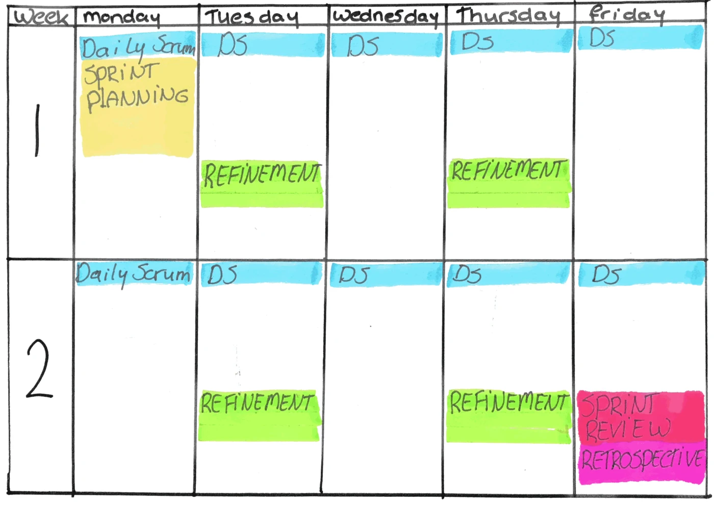

# Scrum

Scrum is a framework for developing and delivering complex products. A Scrum Team is small, typically ten or fewer people, and works in **sprints**: fixed-length iterations of one month or less. Most teams use one or two weeks, because shorter sprints mean faster feedback. Each sprint has a goal, a one or two sentence statement that tells stakeholders what the team is working toward.

The [Scrum Guide](https://scrumguides.org/scrum-guide.html) is the official definition of Scrum, and it's short enough to read in one sitting.

To forecast progress, the Scrum Guide mentions burn-downs, burn-ups, and cumulative flow as useful, while warning that they don't replace empiricism: decisions based on what has actually happened. Many teams also track velocity, a practice from outside Scrum.

?> A sprint isn't a release schedule. The Scrum Guide says an Increment may be delivered to stakeholders before the end of the sprint, and that the Sprint Review should never be considered a gate to releasing value. A Scrum team can deploy as often as it likes.

## Team Composition

The Scrum Guide defines a Scrum Team as one Scrum Master, one Product Owner, and Developers. The team is cross-functional, so together it has every skill needed to deliver, and self-managing, so it decides how to do the work.

> Nothing is more effective than a cross-functional team with a well-defined backlog.
>
> _- Dominica DeGrandis_

### Developers

Developers are the people who do the work, whatever their skill: programmers, testers, designers, writers. They plan the sprint, deliver the work, and meet daily to check progress toward the sprint goal.

### Product Owner

The Product Owner represents the business and decides what is most valuable to build. They:

- **Manage the product backlog.** They are accountable for its contents and order. Anyone who adds to the backlog should talk to the Product Owner.
- **Manage stakeholders.** They balance the needs of users, customers, and the wider organization, so the team delivers the most value.

Trust between the Product Owner and the Developers is crucial.

### Scrum Master

The Scrum Master is accountable for the team's effectiveness. They help the Product Owner manage the backlog, help the Developers remove impediments, and coach the team to improve over time.

## Events

The Scrum Guide defines five events. Each one is a chance to inspect progress and adapt. The timeboxes below are maximums for a one-month sprint. For shorter sprints, the events are usually shorter.

| Event | Purpose | Timebox | Who |
| -- | -- | -- | -- |
| **The Sprint** | The container for all the other events. Each sprint produces at least one usable Increment. | One month or less | Scrum Team |
| **Sprint Planning** | Agree why the sprint is valuable (the Sprint Goal), what can be done, and how. | 8 hours | Scrum Team, plus anyone invited to advise |
| **Daily Scrum** | Inspect progress toward the Sprint Goal and adapt the plan for the next day. | 15 minutes | Developers |
| **Sprint Review** | Inspect the outcome with stakeholders, and decide what to do next. | 4 hours | Scrum Team and stakeholders |
| **Sprint Retrospective** | Plan ways to improve quality and effectiveness. | 3 hours | Scrum Team |

Refinement isn't a Scrum event, but most teams set aside regular time for it (see [Scoping & Refinement](1-ways-of-working/1.3.4-scoping-and-refinement.md)). The calendar below shows one team's cadence with two-week sprints.

### Sprint Planning

Sprint Planning covers three topics. **Why** is this sprint valuable? The Product Owner proposes how the product could gain value, and the team agrees a Sprint Goal. **What** can be done? The Developers select items from the backlog. **How** will the work get done? The Developers plan the work needed. With a well-refined backlog, planning is quick.

### Daily Scrum

The Daily Scrum, often called the stand-up, is for the Developers. The Scrum Guide lets them choose any structure, as long as it focuses on progress toward the Sprint Goal and ends with a plan for the next day. Two common approaches are:

1. **Walk the board.** Review each ticket on the board, with the emphasis on the work in progress.
2. **Around the room.** Each person answers three questions:
   - What did I do yesterday?
   - What am I doing today?
   - Are there any blockers?

### Sprint Review

The team shows stakeholders what it accomplished, and together they decide what to do next. The Scrum Guide calls it a working session, not just a presentation.

### Sprint Retrospective

The team inspects how the sprint went, covering people, interactions, processes, tools, and its Definition of Done. It picks the most helpful improvements to make, and the retrospective ends the sprint.
